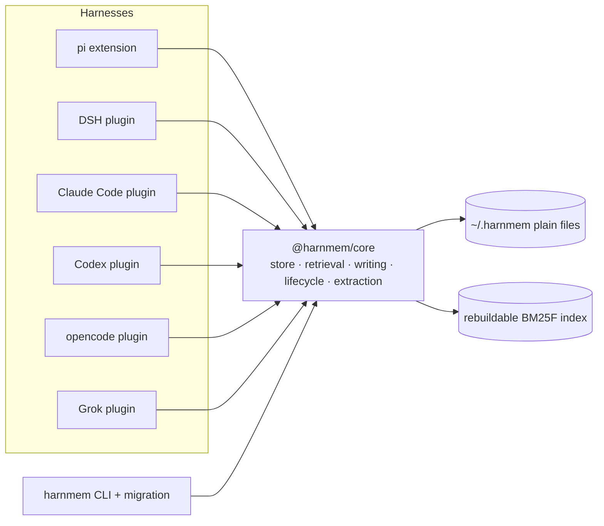

# HarnMem

**Cross-harness agent memory that lives in plain files.**

> HarnMem = *harness* + *memory* (`harn` is also a Scots word for "brains").
> One user, one machine, one memory store — shared by every coding agent you use.


HarnMem is a portable memory system for coding agents. It stores memories as
plain Markdown files under `~/.harnmem/`, retrieves them with a local
deterministic engine, and injects a small, byte-stable hot index into each
harness session. The same store is readable by every adapter and by the CLI, so
a memory written in one harness is available in another — no server, no vector
database, no embedding model, and no runtime dependencies in the engine.

- **Packages:** `@harnmem/core` (engine), `@harnmem/cli` (`harnmem` command),
  `pi-harnmem` (pi extension), `dsh-harnmem` (DSH plugin), `claude-harnmem`
  (Claude Code plugin), `codex-harnmem` (Codex CLI plugin),
  `opencode-harnmem` (opencode v2 plugin), `grok-harnmem` (Grok CLI plugin) and
  `cursor-harnmem` (Cursor desktop plugin) — all published on npm. Install
  the CLI with `npm install -g @harnmem/cli`; the opencode adapter needs
  opencode 2.x and is verified end to end on the 2.1.4 binary (injection, native
  tools, per-turn journaling); the Grok adapter is verified on the 1.0.70 binary
  (MCP `initialize.instructions` injection, six tools, session-end extraction);
  the Cursor adapter is verified on Cursor 3.27.22 (first-prompt injection,
  plugin MCP tools, session-end journaling).
- **License:** MIT.
- **Status:** v0.7.0 — the engine, the CLI/migration tooling and all seven
  adapters (pi, DeepSeek Harness, Claude Code, Codex, opencode, Grok, Cursor) are
  published and tested end to end. The 0.7.0 release adds the Grok and Cursor
  adapters on top of the 0.6.2 seven-package audit wave (17 of 21 confirmed
  issues fixed, the structural remainder tracked as N18-N20 in the roadmap). The
  Codex adapter also covers the CLI TUI trust flow and Codex Desktop, and
  backfills sessions from `~/.codex/sessions` until Codex ships SessionEnd
  hooks.

## Why another memory plugin?

| Approach | Limitation for this use case |
| --- | --- |
| mem0 / Zep / Letta / OpenViking | Requires a service, vector database or Docker; heavy to install and operate |
| pi-memory | Effective inside pi, but not shared with other harnesses and no lifecycle governance |
| dsh-auto-memory | DSH-only; cross-session but not cross-harness |
| Built-in harness memory (e.g. ZCode) | Tied to one harness; store layout not reusable |
| Just put everything in `AGENTS.md` | No retrieval, no governance; grows noisy until models ignore it |

HarnMem's bet: **the source of truth is the file system, retrieval happens in
the local process, and lifecycle decisions are explainable and reversible.**

## Features

- **Cross-harness by construction.** The store and data model are
  harness-agnostic; adapters are thin. The same store is shared by the pi,
  DeepSeek Harness, Claude Code, Codex, opencode and Grok adapters and by the CLI
  without any harness.
- **File-native SSOT.** One memory per Markdown file with YAML frontmatter.
  Indexes and digests are derived and rebuildable; a corrupt index costs a
  rebuild, never data.
- **Zero runtime dependencies.** `@harnmem/core` and `@harnmem/cli` use only
  Node.js built-ins. No native modules, no downloads, no background daemon.
- **Precise recall without embeddings.** CJK-aware tokenization (character
  bigrams), BM25F field weighting, entity/tag/time filters, two-hop link
  diffusion, and an explainable score blending lexical relevance with
  importance, confidence, recency, usage, pins, links and staleness.
- **Memory that ages well.** ADD-only writes with bi-temporal supersede keep
  history; mechanical dedupe/merge keeps the store small; value-based retention
  moves entries active -> archived -> trashed; `trash/` + restore and an
  append-only `state/audit.jsonl` keep it auditable.
- **KV-cache-friendly injection.** The injected block is rebuilt only on session
  start, compaction, memory writes and day rollover, and is byte-identical
  between turns, so prompt caches keep hitting.
- **A vocabulary that grows with your corpus.** The shipped synonym tables are
  generic on purpose; `harnmem synonyms suggest` reads your own memories, asks a
  model for interchangeable terms a co-occurrence pass could never find (Chinese
  jargon usually shares no characters), validates every group against the corpus,
  and writes reviewed proposals to a local `-suggested` table. `synonyms check`
  reports the rank gain before you keep it.
- **Measured, not asserted.** A deterministic evaluation harness covers 12
  scenario suites with hard functional gates and advisory performance gates;
  ablations show which retrieval signals matter.
- **Safe migration.** Importers for DSH, pi, ZCode, Claude Code and Markdown trees
  (plus a relaxed JSON/JSONL/stdin contract) default to dry-run, back up the source,
  record a ledger, verify source integrity, and support per-run rollback. Not sure what
  you have? `harnmem import auto` probes the known stores and prints a plan.

## Quick start

Requirements: **Node.js 22.15+** and **pnpm 10** (`corepack enable`).

### Install

```bash
# CLI (works with every harness, no adapter needed)
npm install -g @harnmem/cli

# pi extension
pi install npm:pi-harnmem

# DSH plugin
dsh plugin --profile desktop add dsh-harnmem

# Claude Code plugin (the repo root is a Claude Code marketplace)
claude plugin marketplace add ys118/harnmem
claude plugin install harnmem@harnmem-marketplace

# Codex CLI plugin (the repo root is also a Codex marketplace)
codex plugin marketplace add ys118/harnmem
codex plugin add harnmem@harnmem-marketplace

# opencode v2 plugin (requires opencode 2.x)
opencode plugin add opencode-harnmem

# Grok CLI plugin (the repo root is also a Grok marketplace)
grok plugin marketplace add ys118/harnmem
grok plugin install grok-harnmem --trust

# Cursor desktop: copy the plugin into ~/.cursor/plugins/local, merge the
# user-level hooks, then run Developer: Reload Window
npx cursor-harnmem-install
```

All adapters read and write the same `~/.harnmem/` store, so installing more
than one shares a single memory. Every install runs fully local; nothing phones
home.

Grok CLI also auto-discovers plugins installed for Claude Code. If
`claude-harnmem` is installed, Grok therefore sees two plugins that declare the
same `harnmem` MCP server; it keeps one, and the explicitly enabled
`grok-harnmem` (its `[plugins] enabled` entry is written by
`grok plugin install`) wins, so sessions get the six Grok tools and the
injected index. To unload the auto-loaded Claude copy entirely (one
`SessionEnd` hook instead of two), add `disabled = ["harnmem"]` under
`[plugins]` in `~/.grok/config.toml`; the entry is harmless when no Claude
plugin is installed. Details:
[`docs/design/11-grok-adapter.md`](docs/design/11-grok-adapter.md).

### Build from source

```bash
corepack enable
pnpm install
pnpm -r build
pnpm test            # every package's test suite (node --test)
```

### pi adapter

```bash
# Try it without installing: load the built extension in a one-shot pi session.
pi -e ./packages/pi-harnmem/dist/index.js -p "Remember: I prefer pnpm over npm."

# From a checkout: install the local path instead of npm:pi-harnmem.
pi install ./packages/pi-harnmem
```

The extension injects the hot index before each turn, registers the memory
tools (`memory_write`, `memory_search`, `memory_read`, `memory_forget`,
`memory_status`), adds `/memory`, and runs a bounded extraction at session end.
Configuration lives in `~/.harnmem/config.json` (or `$HARNMEM_HOME/config.json`).

### DSH adapter

```bash
# From a checkout (instead of the published package in Install above):
pnpm --filter dsh-harnmem build
dsh plugin --profile desktop add ./packages/dsh-harnmem
```

The plugin mounts as a cordis plugin: it injects the same hot index through
`systemPrompt.section` (byte-stable, with a synchronous cold-start fallback),
registers five tools prefixed `harnmem_` (`harnmem_write`, `harnmem_search`,
`harnmem_read`, `harnmem_forget`, `harnmem_status`; the bare `memory_*` names
belong to `dsh-auto-memory`, which DSH keeps when both plugins are installed),
keeps subagent sessions read-only, and runs a bounded session-end extraction
through the host LLM service. Lifecycle and extraction decisions are written to
`~/.harnmem/logs/dsh.jsonl` (`log: "on"` is the trial default), and every
extraction outcome is emitted as a `kind:"extract"` event in
`~/.harnmem/state/audit.jsonl`. It requires DSH 0.2.x and never opens a network
connection of its own. On the DSH web GUI the plugin also registers a read-only
Memory panel (overview, memory list, detail, index and injection preview).

### Claude Code adapter

Installed via the marketplace commands above (requires Claude Code 2.1.x,
verified against 2.1.310). The plugin:

- injects the hot index through a `SessionStart` hook — byte-stable between
  turns, an empty store injects zero bytes, and output is deterministically
  truncated under Claude's 10,000-character `additionalContext` cap;
- exposes the five memory tools through a bundled, zero-dependency stdio MCP
  server (`memory_search`, `memory_read`, `memory_write`, `memory_forget`,
  `memory_status`; tool outputs are clipped well under the client's 25k-token
  cap);
- adds a `/harnmem:memory` slash command for manual search/read/write/forget/
  status;
- runs session-end extraction in a detached child process (plugin hook timeout
  declarations are not honored upstream, so the hook must return immediately);
- keeps subagent sessions read-only (Task subagents fire no session hooks on
  2.1.310; the guards are a forward-compatible safety net).

`@harnmem/core` is vendored into the plugin package, so the installed plugin
directory is self-contained. For development against a checkout,
`claude plugin marketplace add D:\projects\harnmem` (or the equivalent POSIX
path) reads the repo live — code changes apply on the next session.

### Codex adapter

Installed via the marketplace commands above (requires the codex 0.164/0.165
alpha engines; verified on Windows). The plugin:

- injects the hot index through a `SessionStart` `mcp_tool` hook — the tool
  output lands as a developer message, is byte-stable between turns, and an
  empty store injects nothing;
- exposes the five memory tools plus two internal hook targets through a
  bundled, zero-dependency stdio MCP server (7 tools total);
- ships a skill that teaches the model when to search and when to write;
- backfills on every session start: rollouts under `~/.codex/sessions` newer
  than a durable cursor are journaled exactly once, so a session that closed
  without extraction is still captured. Codex does not support SessionEnd
  hooks yet — the hook is declared and skipped by current engines;
- honors the one-time TUI trust ceremony ("Hooks need review"); Codex Desktop
  follows the same persisted trust state in `config.toml`.

See the [package README](packages/codex-harnmem/README.md) for configuration
and the [probe record](docs/research/codex-plugin.md) for the full
verification trail.

### CLI

```bash
node packages/cli/dist/main.js --help
node packages/cli/dist/main.js stats
node packages/cli/dist/main.js search "deployment rule" --limit 5
node packages/cli/dist/main.js write --type feedback \
  --title "Never force-push main" \
  --content "Why: shared repo. How to apply: open a PR." --importance 7

# Migrate legacy memories: dry-run by default, then --apply
node packages/cli/dist/main.js import auto          # probe known stores (DSH/pi/ZCode/Claude Code)
node packages/cli/dist/main.js import dsh
node packages/cli/dist/main.js import md --path ./notes --apply   # any Markdown tree
node packages/cli/dist/main.js import json --path export.json      # any JSON/JSONL export

# Grow the local synonym table from your own memories (nothing is auto-applied)
node packages/cli/dist/main.js synonyms list
node packages/cli/dist/main.js synonyms suggest --llm-url http://127.0.0.1:11434/v1 --llm-model qwen3:8b
node packages/cli/dist/main.js synonyms check
```

### Evaluation

```bash
node evals/gen/generate.mjs           # generate deterministic corpora
node evals/gen/generate.mjs --check   # prove a second generation is byte-identical
pnpm eval                             # all suites
pnpm eval:gate                        # hard gates (perf gates are advisory)
```

## Architecture



A session looks like this:

1. **Session start / resume:** the adapter calls `ensureContext()`; core returns
   a hot index (pinned entries, high-value entries, recent entries, digest
   lines) within a token budget. The adapter injects it into the system prompt
   once and keeps it byte-stable until it is invalidated.
2. **During the session:** the model uses the memory tools (or the CLI) to
   write, search, read, forget and inspect memories. Writes are deduplicated
   and scoped; conflicting facts supersede old ones instead of overwriting
   history.
3. **Session end:** the adapter sends a transcript digest to one bounded LLM
   call, then writes the extracted memories (deduped against the existing
   store, with a confidence threshold and an idempotent cursor).
4. **Between sessions:** consolidation merges near-duplicates, retires stale
   entries by value/age, and (optionally) writes topic digests.

## What a memory looks like

```markdown
---
schema: 1
id: mem_01J8Z6Q0K4T9B2M7R5X3C8V1ND
type: feedback
category: workflow
scope: project
project: my-app-4f2a91c3d0
title: Never force-push main
description: Shared repository requires PRs; force-push rewrites others' history.
importance: 7
confidence: 0.9
pinned: false
status: active
created: 1760918400000
updated: 1760918400000
tags: [git, workflow]
links: []
supersedes: []
---

**Why:** `main` is shared; rewriting history disrupts other contributors.
**How to apply:** push feature branches and open a pull request.
```

Types are `user`, `feedback`, `project` and `reference`. Records are
append-only: a corrected fact creates a new record and marks the old one
`status: superseded` with `valid_to` set, so "what did I believe last month?"
is still answerable.

## Data layout

Default `~/.harnmem/` (Windows: `C:\Users\<you>\.harnmem\`):

```
~/.harnmem/
├── config.json          # optional user config (budgets, weights, governance)
├── VERSION              # store layout version
├── memories/            # SSOT: one .md file per memory
│   ├── user/            # global, cross-project scope
│   └── projects/<projectId>/
├── digests/             # optional topic digests produced by consolidation
├── prompts/             # prompt assets deployed on first run (editable)
├── data/                # synonym tables, one file per language, deployed on first run (editable)
├── projects.json        # project identity registry (git remote/path -> id)
├── index/               # derived indexes; safe to delete, rebuilt on demand
├── sessions/            # raw session journals used as extraction input
├── state/               # sequence numbers, audit log, cursors, usage overlay
├── trash/               # soft-deleted entries (30-day grace, restorable)
└── logs/                # adapter logs, e.g. logs/pi.jsonl
```

The schema and migration mapping are specified in
[`docs/design/02-data-model.md`](docs/design/02-data-model.md).

## Retrieval and ranking

Retrieval is deliberately local and explainable:

- tokenizer: English words + Chinese character bigrams (queries avoid
  boundary-unigram noise);
- BM25F over title/description/tags/entities/body with per-field weights;
- a scored blend: lexical relevance, importance, confidence, recency
  (`0.995^hours`), usage, pin, two-hop link diffusion, and a staleness penalty;
- MMR diversification and a token budget for injection;
- abstention when the best lexical evidence is too weak (prevents injecting
  irrelevant context).

The formula and its calibration are documented in
[`docs/design/03-retrieval.md`](docs/design/03-retrieval.md).

## Evaluation results

The harness is deterministic (no LLM, no network) and runs in about a minute; the numbers below come from the tracked [`eval-report.md`](evals/results/eval-report.md):

| Metric | Result |
| --- | --- |
| Suites / queries / documents | 12 (S1-S12) / 565 / 27,510 |
| Macro Recall@10 | **1.000** |
| MRR | **0.891** |
| nDCG@10 | **0.911** |
| Cross-language (zh <-> en) recall gap | 0.000 |
| Functional gates | all passing |
| Advisory performance items | 10k import ~12 s; warm search p95 ~16 ms; index ~2.9x canonical store |

The advisory items are recorded rather than hidden: import is a one-time
migration cost, and the index-size/latency targets for very large stores are on
the roadmap. Details, per-suite numbers, ablations and gate definitions are in
[`docs/design/05-evaluation.md`](docs/design/05-evaluation.md) and
[`evals/README.md`](evals/README.md).

## Harness support

| Harness | Status | Notes |
| --- | --- | --- |
| pi 1.3.0+ | **Supported** | Extension with injection, tools, `/memory`, session-end extraction; verified end to end on 1.3.0, and the peer range accepts 1.4.x |
| DeepSeek Harness 0.2.1 | **Supported** (0.2.x) | Cordis plugin (`dsh-harnmem`); verified against the desktop runtime with a disposable profile and a local mock endpoint |
| CLI (any harness) | **Supported** | `harnmem` commands read/write the same store |
| Claude Code 2.1.x | **Supported** | `claude-harnmem` plugin (SessionStart hook + stdio MCP + `/harnmem:memory`); verified end to end against 2.1.310; `harnmem import claude` migrates existing stores |
| Codex CLI 0.164/0.165 alpha | **Supported** (Windows) | `codex-harnmem` plugin (SessionStart `mcp_tool` hook → developer-message injection + stdio MCP + skill + rollout backfill); verified end to end on the CLI, the TUI trust flow and Codex Desktop; extraction is backfilled until Codex ships SessionEnd hooks |
| opencode 2.1.4 | **Supported** (2.x) | `opencode-harnmem` plugin (byte-stable `session.hook("context")` snapshot + five native tools + per-turn journaling; child sessions run read-only); verified end to end on the 2.1.4 binary |
| Grok CLI 1.0.70 | **Supported** (1.0.x) | `grok-harnmem` plugin (memory index via MCP `initialize.instructions` — Grok's `SessionStart` is observe-only; six tools + `/grok-harnmem:memory` + `SessionEnd` extraction from `chat_history.jsonl`); verified end to end on the 1.0.70 binary |
| Other harnesses | Welcome | See the adapter contract and `CONTRIBUTING.md` |

## Documentation

Start with the [documentation index](docs/README.md). Highlights:

- [User guide](docs/user-guide.md)
- [FAQ](docs/faq.md)
- [Design overview](docs/design/00-overview.md)
- [Data model](docs/design/02-data-model.md)
- [Retrieval](docs/design/03-retrieval.md)
- [Write lifecycle](docs/design/04-write-and-lifecycle.md)
- [Evaluation](docs/design/05-evaluation.md)
- [Adapter contract](docs/design/07-adapter-contract.md)
- [Migration onboarding](docs/design/10-migration-onboarding.md)
- [Adapter authoring guide](docs/adapter-authoring.md)
- [Agent workflow contract](AGENTS.md)

## Roadmap

See [`docs/ROADMAP.md`](docs/ROADMAP.md) for the current status (verified
numbers, the running trial, known issues) and the ordered next steps.

- **Codex adapter** — shipped as `codex-harnmem`; see its
  [README](packages/codex-harnmem/README.md) and the probe record in
  [`docs/research/codex-plugin.md`](docs/research/codex-plugin.md).
- **Grok adapter** — shipped as `grok-harnmem`; see its
  [README](packages/grok-harnmem/README.md), [`docs/design/11-grok-adapter.md`](docs/design/11-grok-adapter.md)
  and the probe record in [`docs/research/grok-plugin.md`](docs/research/grok-plugin.md).
- Persist and incrementally update indexes so large stores warm up faster;
  reduce index size.
- Validate npm installs on Linux/macOS/Windows and publish provenance for
  every release.
- Harden concurrent writes across harnesses sharing one home.
- Add an optional, opt-in reranker or LLM selector for ambiguous recalls
  (never required for basic use).

## Security and privacy

HarnMem is local-first: no telemetry, no background service, and the engine never
opens a network connection. The CLI is offline by default too; the only outbound
call is the opt-in `harnmem synonyms suggest --llm-url` bridge, which runs solely
when you pass an endpoint. Memory content is sensitive by nature — back up
`~/.harnmem/`, keep it out of version control, and read
[SECURITY.md](SECURITY.md) before reporting a vulnerability. The store uses
symlink/path containment checks, size caps, sensitive-value redaction, soft
delete and an audit log; see the design docs for details.

## Contributing

Contributions are welcome. Start with [CONTRIBUTING.md](CONTRIBUTING.md), follow
the [Code of Conduct](CODE_OF_CONDUCT.md), and run `pnpm test` and
`pnpm eval:gate` before opening a pull request. Note the contribution gate:
issues and pull requests from new contributors are auto-closed by default and
reopened once a maintainer approves them with `lgtmi` (issues) or `lgtm`
(issues and pull requests). Merging `master` is PR-only and requires the owner's
approval. If you drive an AI coding agent, point it at [AGENTS.md](AGENTS.md):
every change goes through a worktree branch and a pull request, and agents never
push to `master`. Questions and ideas are welcome in
[Discussions](https://github.com/ys118/harnmem/discussions). Security issues go
through the private process in [SECURITY.md](SECURITY.md).

## License

[MIT](LICENSE) © HarnMem contributors
