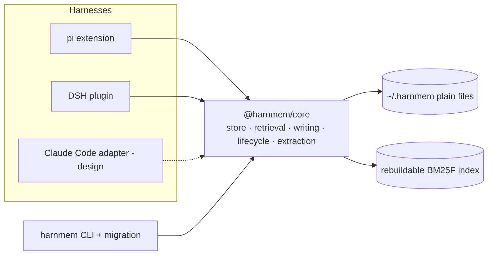

# HarnMem

**Cross-harness agent memory that lives in plain files.**

> HarnMem = *harness* + *memory* (`harn` is also a Scots word for "brains").
> One user, one machine, one memory store — shared by every coding agent you use.


HarnMem is a portable memory system for coding agents. It stores memories as
plain Markdown files under `~/.harnmem/`, retrieves them with a local
deterministic engine, and injects a small, byte-stable hot index into each
harness session. The same store is readable by every adapter and by the CLI, so
a memory written in one harness is available in another — no server, no vector
database, no embedding model, and no runtime dependencies in the engine.

- **Package:** `@harnmem/core` (engine), `@harnmem/cli` (`harnmem` command),
  `pi-harnmem` (pi extension), `dsh-harnmem` (DSH plugin). Not published to npm
  yet; build from a checkout.
- **License:** MIT.
- **Status:** v0.1.0 — core, CLI/migration, the pi adapter and the DSH adapter
  are usable and tested end to end; the Claude Code adapter is designed but not
  built.

## Why another memory plugin?

| Approach | Limitation for this use case |
| --- | --- |
| mem0 / Zep / Letta / OpenViking | Requires a service, vector database or Docker; heavy to install and operate |
| pi-memory | Effective inside pi, but not shared with other harnesses and no lifecycle governance |
| dsh-auto-memory | DSH-only; cross-session but not cross-harness |
| Built-in harness memory (e.g. ZCode) | Tied to one harness; store layout not reusable |
| Just put everything in `AGENTS.md` | No retrieval, no governance; grows noisy until models ignore it |

HarnMem's bet: **the source of truth is the file system, retrieval happens in
the local process, and lifecycle decisions are explainable and reversible.**

## Features

- **Cross-harness by construction.** The store and data model are
  harness-agnostic; adapters are thin. The pi adapter is the first one, and the
  CLI can read the same store without any harness.
- **File-native SSOT.** One memory per Markdown file with YAML frontmatter.
  Indexes and digests are derived and rebuildable; a corrupt index costs a
  rebuild, never data.
- **Zero runtime dependencies.** `@harnmem/core` and `@harnmem/cli` use only
  Node.js built-ins. No native modules, no downloads, no background daemon.
- **Precise recall without embeddings.** CJK-aware tokenization (character
  bigrams), BM25F field weighting, entity/tag/time filters, two-hop link
  diffusion, and an explainable score blending lexical relevance with
  importance, confidence, recency, usage, pins, links and staleness.
- **Memory that ages well.** ADD-only writes with bi-temporal supersede keep
  history; mechanical dedupe/merge keeps the store small; value-based retention
  moves entries active -> archived -> trashed; `trash/` + restore and an
  append-only `state/audit.jsonl` keep it auditable.
- **KV-cache-friendly injection.** The injected block is rebuilt only on session
  start, compaction, memory writes and day rollover, and is byte-identical
  between turns, so prompt caches keep hitting.
- **Measured, not asserted.** A deterministic evaluation harness covers 12
  scenario suites with hard functional gates and advisory performance gates;
  ablations show which retrieval signals matter.
- **Safe migration.** Importers for DSH, pi, ZCode and JSON default to dry-run,
  back up the source, record a ledger, verify source integrity, and support
  rollback.

## Quick start

Requirements: **Node.js 22.15+** and **pnpm 10** (`corepack enable`).

```bash
corepack enable
pnpm install
pnpm -r build
pnpm test            # core test suite: node --test, 19 tests
```

### pi adapter

```bash
# Try it without installing: load the built extension in a one-shot pi session.
pi -e ./packages/pi-harnmem/dist/index.js -p "Remember: I prefer pnpm over npm."

# Install it as a persistent pi extension.
pi install ./packages/pi-harnmem
```

The extension injects the hot index before each turn, registers the memory
tools (`memory_write`, `memory_search`, `memory_read`, `memory_forget`,
`memory_status`), adds `/memory`, and runs a bounded extraction at session end.
Configuration lives in `~/.harnmem/config.json` (or `$HARNMEM_HOME/config.json`).

### DSH adapter

```bash
pnpm --filter dsh-harnmem build
dsh plugin --profile desktop add ./packages/dsh-harnmem
```

The plugin mounts as a cordis plugin: it injects the same hot index through
`systemPrompt.section` (byte-stable, with a synchronous cold-start fallback),
registers the same five tools, keeps subagent sessions read-only, and runs a
bounded session-end extraction through the host LLM service. It requires DSH
0.2.x and never opens a network connection of its own.

### CLI

```bash
node packages/cli/dist/main.js --help
node packages/cli/dist/main.js stats
node packages/cli/dist/main.js search "deployment rule" --limit 5
node packages/cli/dist/main.js write --type feedback \
  --title "Never force-push main" \
  --content "Why: shared repo. How to apply: open a PR." --importance 7

# Migrate legacy memories: dry-run by default, then --apply
node packages/cli/dist/main.js import dsh
node packages/cli/dist/main.js import pi --apply
```

### Evaluation

```bash
node evals/gen/generate.mjs           # generate deterministic corpora
node evals/gen/generate.mjs --check   # prove a second generation is byte-identical
pnpm eval                             # all suites
pnpm eval:gate                        # hard gates (perf gates are advisory)
```

## Architecture



A session looks like this:

1. **Session start / resume:** the adapter calls `ensureContext()`; core returns
   a hot index (pinned entries, high-value entries, recent entries, digest
   lines) within a token budget. The adapter injects it into the system prompt
   once and keeps it byte-stable until it is invalidated.
2. **During the session:** the model uses the memory tools (or the CLI) to
   write, search, read, forget and inspect memories. Writes are deduplicated
   and scoped; conflicting facts supersede old ones instead of overwriting
   history.
3. **Session end:** the adapter sends a transcript digest to one bounded LLM
   call, then writes the extracted memories (deduped against the existing
   store, with a confidence threshold and an idempotent cursor).
4. **Between sessions:** consolidation merges near-duplicates, retires stale
   entries by value/age, and (optionally) writes topic digests.

## What a memory looks like

```markdown
---
schema: 1
id: mem_01J8Z6Q0K4T9B2M7R5X3C8V1ND
type: feedback
category: workflow
scope: project
project: my-app-4f2a91c3d0
title: Never force-push main
description: Shared repository requires PRs; force-push rewrites others' history.
importance: 7
confidence: 0.9
pinned: false
status: active
created: 1760918400000
updated: 1760918400000
tags: [git, workflow]
links: []
supersedes: []
---

**Why:** `main` is shared; rewriting history disrupts other contributors.
**How to apply:** push feature branches and open a pull request.
```

Types are `user`, `feedback`, `project` and `reference`. Records are
append-only: a corrected fact creates a new record and marks the old one
`status: superseded` with `valid_to` set, so "what did I believe last month?"
is still answerable.

## Data layout

Default `~/.harnmem/` (Windows: `C:\Users\<you>\.harnmem\`):

```
~/.harnmem/
├── config.json          # optional user config (budgets, weights, governance)
├── VERSION              # store layout version
├── memories/            # SSOT: one .md file per memory
│   ├── user/            # global, cross-project scope
│   └── projects/<projectId>/
├── digests/             # optional topic digests produced by consolidation
├── prompts/             # prompt assets deployed on first run (editable)
├── data/                # synonym tables deployed on first run (editable)
├── projects.json        # project identity registry (git remote/path -> id)
├── index/               # derived indexes; safe to delete, rebuilt on demand
├── sessions/            # raw session journals used as extraction input
├── state/               # sequence numbers, audit log, cursors, usage overlay
├── trash/               # soft-deleted entries (30-day grace, restorable)
└── logs/                # adapter logs, e.g. logs/pi.jsonl
```

The schema and migration mapping are specified in
[`docs/design/02-data-model.md`](docs/design/02-data-model.md).

## Retrieval and ranking

Retrieval is deliberately local and explainable:

- tokenizer: English words + Chinese character bigrams (queries avoid
  boundary-unigram noise);
- BM25F over title/description/tags/entities/body with per-field weights;
- a scored blend: lexical relevance, importance, confidence, recency
  (`0.995^hours`), usage, pin, two-hop link diffusion, and a staleness penalty;
- MMR diversification and a token budget for injection;
- abstention when the best lexical evidence is too weak (prevents injecting
  irrelevant context).

The formula and its calibration are documented in
[`docs/design/03-retrieval.md`](docs/design/03-retrieval.md).

## Evaluation results (v0.1.0)

The harness is deterministic (no LLM, no network) and runs in about a minute:

| Metric | Result |
| --- | --- |
| Suites / queries / documents | 12 (S1-S12) / 565 / 27,510 |
| Macro Recall@10 | **1.000** |
| MRR | **0.891** |
| nDCG@10 | **0.911** |
| Cross-language (zh <-> en) recall gap | 0.000 |
| Functional gates | all passing |
| Advisory performance items | 10k import ~12 s; warm search p95 ~16 ms; index ~2.9x canonical store |

The advisory items are recorded rather than hidden: import is a one-time
migration cost, and the index-size/latency targets for very large stores are on
the roadmap. Details, per-suite numbers, ablations and gate definitions are in
[`docs/design/05-evaluation.md`](docs/design/05-evaluation.md) and
[`evals/README.md`](evals/README.md).

## Harness support

| Harness | Status | Notes |
| --- | --- | --- |
| pi 1.3.0 | **Supported** | Extension with injection, tools, `/memory`, session-end extraction; verified end to end |
| DeepSeek Harness 0.2.1 | **Supported** (0.2.x) | Cordis plugin (`dsh-harnmem`); verified against the desktop runtime with a disposable profile and a local mock endpoint |
| CLI (any harness) | **Supported** | `harnmem` commands read/write the same store |
| Claude Code | Design | [`docs/design/09-claude-adapter.md`](docs/design/09-claude-adapter.md) (MCP stdio server + hooks) |
| Other harnesses | Welcome | See the adapter contract and `CONTRIBUTING.md` |

## Documentation

Start with the [documentation index](docs/README.md). Highlights:

- [User guide](docs/user-guide.md)
- [Design overview](docs/design/00-overview.md)
- [Data model](docs/design/02-data-model.md)
- [Retrieval](docs/design/03-retrieval.md)
- [Write lifecycle](docs/design/04-write-and-lifecycle.md)
- [Evaluation](docs/design/05-evaluation.md)
- [Adapter contract](docs/design/07-adapter-contract.md)

## Roadmap

- Implement the Claude Code adapter (MCP stdio + hooks).
- Persist and incrementally update indexes so large stores warm up faster;
  reduce index size.
- Publish the packages to npm and validate installs on Linux/macOS/Windows.
- Harden concurrent writes across harnesses sharing one home.
- Add an optional, opt-in reranker or LLM selector for ambiguous recalls
  (never required for basic use).

## Security and privacy

HarnMem is local-first: no telemetry, no network calls in the engine or CLI, no
background service. Memory content is sensitive by nature — back up
`~/.harnmem/`, keep it out of version control, and read
[SECURITY.md](SECURITY.md) before reporting a vulnerability. The store uses
symlink/path containment checks, size caps, sensitive-value redaction, soft
delete and an audit log; see the design docs for details.

## Contributing

Contributions are welcome. Start with [CONTRIBUTING.md](CONTRIBUTING.md), follow
the [Code of Conduct](CODE_OF_CONDUCT.md), and run `pnpm test` and
`pnpm eval:gate` before opening a pull request. Security issues go through the
private process in [SECURITY.md](SECURITY.md).

## License

[MIT](LICENSE) © HarnMem contributors
