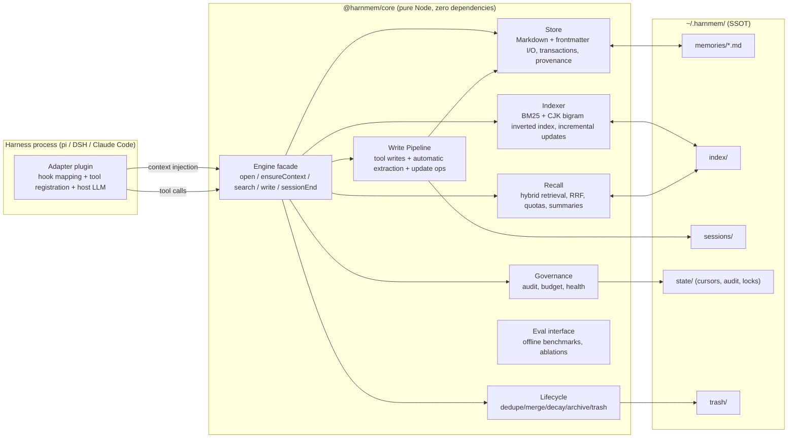
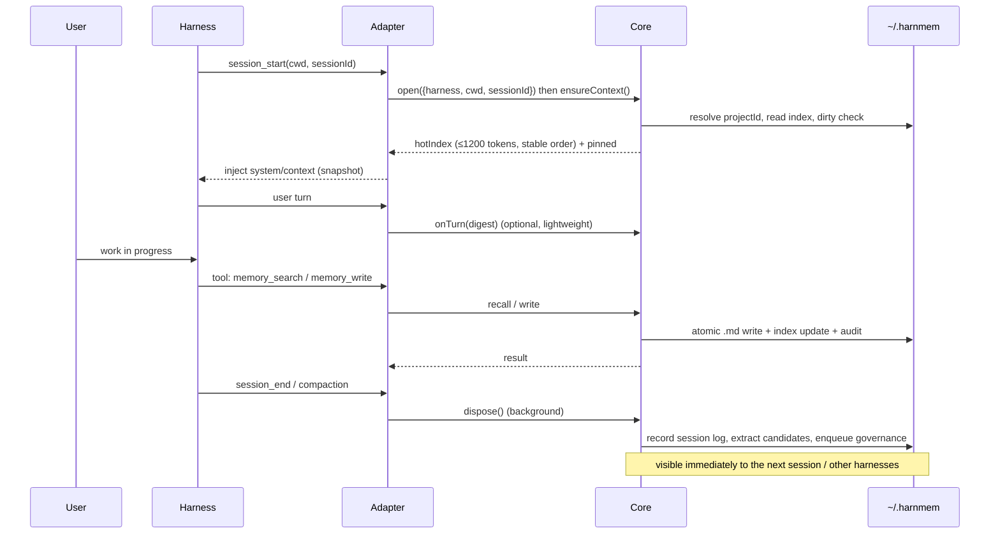

# 00 · Overview: goals, constraints, and design principles

## 1. The problem

Users work with several coding harnesses at once (pi / DeepSeek Harness / Claude Code, and possibly opencode or ZCode in the future). Every harness's memory plugin only works inside its own process, which leads to:

- The same "user preferences / project decisions / lessons learned" must be accumulated separately in each harness, making every cold start expensive.
- Memory cannot be reused across harnesses: a lesson learned in DSH is unknown to pi.
- Each plugin has its own storage format, lifecycle, and size limits, so there is no unified management.
- Existing plugins generally "store little, retrieve poorly, and govern nothing": they are either a few KB of index files or an ever-growing stream of raw notes that the model eventually ignores.

**What we are building**: turn memory from "a feature of one harness" into "**one user's memory on one machine**", where harnesses are only responsible for integration and injection.

## 2. Goals

| # | Goal | Acceptance criteria |
|---|---|---|
| G1 | **Lightweight, works out of the box** | Zero external services, zero middleware, zero local models, zero runtime npm dependencies; `git clone` plus one install command is enough |
| G2 | **Cross-session + cross-harness** | The same `~/.harnmem/` is read and written by pi / DSH / Claude Code; anything written by one harness is visible to the others on their next session |
| G3 | **High capacity + high-precision recall** | Comfortably supports on the order of 10k memories; primarily Chinese with mixed English; search p95 < 50ms; memories are retrieved on demand rather than injected wholesale |
| G4 | **Rich memory content** | A single memory can carry full context (decision, rationale, constraints, code locations, links); it is not forced into "one sentence" |
| G5 | **Intelligent governance** | Automatic dedupe/merge/update/forget; distinguishes high value (importance × usage feedback × recency) from stale (superseded, long unused); never grows without bound |
| G6 | **Explainable, reversible, user-sovereign** | Files are readable and editable; every injection/write/merge/archive is audited; deletion goes to trash first; pinned memories are never auto-cleaned |
| G7 | **Evaluable, iterable** | Ships with deterministic offline evaluation (retrieval metrics + behavioral metrics); every change is compared against a baseline instead of "feels better" |
| G8 | **Extensible adapters** | Core is decoupled from harnesses; a new harness only needs about 6 hooks + tool registration, with no changes to core |

## 3. Non-goals (v1)

- No GUI / web UI (CLI + files + in-harness status is enough).
- No cross-device sync (users can sync `~/.harnmem/` with OneDrive/git/Syncthing; the directory design keeps it syncable).
- No multi-user / team-shared memory (single user, single machine).
- No storage of passwords, tokens, keys, or other sensitive credentials (the extraction path applies regex redaction + a sensitive flag).
- No bundled embedding model or vector database; an optional user-provided embedding API is a progressive enhancement.
- Never automatically modify the user's AGENTS.md / CLAUDE.md (memory is kept separate from "standing instructions" to avoid contamination).

## 4. Design principles

### P1. Files are the SSOT; indexes are rebuildable
Memory data = `~/.harnmem/memories/**/*.md` (Markdown + a YAML-subset frontmatter). Indexes, caches, and session logs are all **derived data** that can be rebuilt from files after deletion. At any time the user can `cat` a memory, edit it in an editor, or version it with git.

### P2. Progressive enhancement (graceful degradation)
The system works without an LLM: the agent calls the `memory_write` tool explicitly, and mechanical governance handles hash dedupe, time decay, and capacity budgets. When an LLM is available, it adds automatic extraction, semantic merging, conflict resolution, and periodic distillation. **No missing capability may make the system unusable.**

### P3. Host-agnostic
`@harnmem/core` imports no harness SDK and assumes no runtime (Node / Bun / Electron all work). All harness differences are confined to the adapter's "hook mapping + LLM invocation + tool registration".

### P4. Stable injection (KV-cache friendly)
The hot-memory listing is injected as a **session snapshot** (at session start, or rebuilt on compaction/resume), not changed on every turn; it is refreshed only by explicit events such as writing a new memory or crossing a day boundary. Detail retrieval goes through tool calls, keeping "change" isolated in tool results.

### P5. Precise recall over "stuff everything in"
Injection budgets should be small rather than large (defaults: ≤ 1200 tokens for the hot index + ≤ 1200 tokens per on-demand search, both adjustable in config). What enters the prompt is decided by retrieval ranking, type quotas, and scope filtering together; large passages stay in files and are fetched with `memory_read`.

### P6. Explainable and reversible
Every memory has a `source` (harness/session/turn) and a change history; merges/archives are audited; deletions go to trash; `supersedes` / `links` preserve semantic relationships.

### P7. Governance is "consumer-grade", not "database-grade"
No complex knowledge graphs or online learning. Explainable heuristics (importance, recency, recall feedback, dedupe similarity) plus a small amount of LLM judgment cover 95% of scenarios; every threshold is configurable and evaluable.

## 5. Overall architecture

**Lifecycle of one session (pi as an example)**:

## 6. Capacity and budget model (design targets)

> This table lists **product targets** (long-term goals); the engine's current defaults live in `DEFAULT_GOVERNANCE` / `DEFAULT_BUDGET` in `packages/core/src/config.ts`, and have been synchronized into 01 §7 and 04 §8: record counts user 500 / project 3000 (soft budgets), per-record body limit 64KB, injection 1200 tokens, search 1200 tokens. Where a target differs from a default, the config default wins.

| Dimension | Target | Notes |
|---|---|---|
| Memory count | Comfortably 10k; soft budgets configurable (default user 500 / project 3000) | Exceeding limits triggers merge/archive, never hard deletion |
| Per-record size | Body recommended ≤ 8KB by default; hard limit 64KB | Split long content or store it as `reference` |
| Retrieval latency | p95 < 50ms at 10k records (pure JS) | Cold-start index build < 2s |
| Injection budget | Hot index 1200 tokens by default (configurable 800–2000); each search returns ≤ 1200 tokens | Configurable |
| Index size | ≤ 20% of the corpus | Inverted index + doc metadata, sharded JSON/binary; current measurements are far above this (see 05/06) |
| Session logs | 30 days hot + archived and compressed | Not used in retrieval after extraction |

## 7. Relationship to existing solutions

- **Borrowed from ZCode**: one memory directory per project + a `MEMORY.md` index + topic files + a background extraction subagent + index-injection truncation policy.
- **Borrowed from pi-memory**: single-file extension shape, stable snapshot injection (KV-cache), a scratchpad workspace, and the `memory_search` tool.
- **Borrowed from dsh-auto-memory**: the user/feedback/project/reference taxonomy, `_user` global scope, audit log, and auto-summarize toggle.
- **Borrowed from mem0**: extraction followed by `ADD/UPDATE/DELETE/NOOP` update operators (solves "a new fact overwrites an old one").
- **Borrowed from Generative Agents / MemoryBank**: importance, time decay, and recall reinforcement (used for governance and ranking).
- **Rejected**: external services, vector databases, local embedding models, graph databases, and other heavy dependencies.

## 8. Glossary

| Term | Meaning |
|---|---|
| Memory | One persisted fact, corresponding to one `.md` file with frontmatter + body |
| Scope | `user` (global) or `project` (within a project) |
| Project identity | A harness-stable project identifier: the normalized git remote URL if available, otherwise a hash of the normalized absolute path |
| Hot index | The compact listing injected into the model: title + a one-sentence hook + type/tags |
| Recall | Retrieve by query and assemble the content returned to the model |
| Extraction | Extract candidate memories from a session (works without an LLM; quality is higher with one) |
| Consolidation | Merge, rewrite, dedupe, and resolve conflicts |
| Decay | Reduce effective importance over time / based on usage feedback |
| Archive | Move low-value memories to the archive: no longer injected/retrieved by default, but recoverable |
| Scratchpad | In-session temporary notes that do not enter the long-term SSOT |
