# 03 · Retrieval: indexing, tokenization, ranking, and injection budgets

> Goal: **on the order of 10k records (scalable to 100k), primarily Chinese with mixed English, search p95 < 5ms (0.28ms measured on this machine), injection p95 ≤ 1200 tokens, zero dependencies**. Recall should be "few but precise": by default no body text is injected, only a layered hot index; details are fetched on demand with the `read` tool.

## 1. Overall flow

```mermaid
flowchart LR
    Q["query"] --> N["normalize NFKC + lowercase"]
    N --> T["tokenize<br/>English words + CJK character bigrams"]
    T --> P["inverted postings<br/>BM25F field weighting"]
    P --> F["hard filters<br/>status/scope/type/time"]
    F --> S["composite score<br/>lex+imp+conf+rec+use+pin+link−stale"]
    S --> G["graph diffusion<br/>top-3 seeds along links, two hops"]
    G --> M["MMR dedupe λ=0.7"]
    M --> B["budget fill<br/>≤8 entries / ≤1200 tokens"]
    B --> O["assembly<br/>summary + id + optional snippet"]
```



## 2. Tokenization and normalization (implementation: `packages/core/src/text.ts`; the design phase planned `text/tokenize.ts`)

**Normalization**: Unicode NFKC (full-width → half-width) → lowercase → whitespace folding; keep intra-word `+ # . / -` (`cross-harness`, `v0.9.0`, `file.ts`) — split on punctuation first, then re-merge `\d+\.\d+` and hyphenated English words. **No dictionary is used**.

```ts
// Measured: 10k documents, avg 14.4 tokens/doc, build 45ms, query p95 0.28ms (Node 24 / i5-11400F)
export function tokenize(text: string): string[] {
  const out: string[] = [];
  const re = /[\u4e00-\u9fff]+|[A-Za-z0-9_]+/g;
  let m: RegExpExecArray | null;
  while ((m = re.exec(text))) {
    const t = m[0];
    if (/[\u4e00-\u9fff]/.test(t)) {
      if (t.length === 1) { out.push(t); continue; }      // fallback for single-character queries
      for (let i = 0; i < t.length - 1; i++) out.push(t.slice(i, i + 2)); // 用户偏好 → 用户/户偏/偏好
      out.push(t[0], t[t.length - 1]);                    // boundary single chars, fallback for 1-char queries
    } else out.push(t.toLowerCase());
  }
  return out;
}
```

**Why bigrams**: zero dependencies, and robust to out-of-vocabulary words, new words, and mixed Chinese/English text. The known cost is weak recall on "same-meaning rewording" → compensated by ① a small synonym table ② `entities`/`links` graph diffusion ③ entity filtering (see §3.4/§5). Traditional↔simplified folding is not done yet (an optional `synonyms.zh-trad.txt` can be loaded).

**Indexed text uses only**: `title`, `description`, `tags`, `entities`, and the first 8KB of the body (long bodies are not indexed in full; `read` returns the full text).

## 3. Ranking

### 3.1 Lexical layer: BM25F (`packages/core/src/text/bm25.ts`)

```text
w_tf(d,t) = 3.0·tf_title + 2.5·tf_tags + 2.0·tf_desc + 1.0·tf_body
len(d)    = 3.0·|title| + 2.5·|tags| + 2.0·|desc| + 1.0·|body|
score_lex = Σ_t IDF(t)·w_tf·(k1+1) / (w_tf + k1·(1−b + b·len/avg_len))
IDF(t)    = ln(1 + (N−df+0.5)/(df+0.5))
k1 = 1.2, b = 0.75
```

- **Per-shard statistics** (user / each project) to avoid cross-scope IDF contamination;
- Query-side term deduplication (prevents query stuffing);
- Each query touches only 1–2 shards, typically < 50ms cold load (10k-document build measured at 45ms).

### 3.2 Composite scoring (default weights, adjustable in config)

```text
# Hard filters (not part of ranking): status==active (with --as-of, filter by valid_from/valid_to);
#   scope ∈ {user, current_project}; if project does not match, keep only user; sensitive entries excluded by default.
lex  = (raw / maxRaw) × (raw / (raw + 2))   # calibration note below
imp  = importance / 10
conf = confidence
rec  = 0.995 ^ hours_since(max(last_used, updated))
use  = min(1, log1p(used_count) / log1p(20))
pin  = pinned ? 1 : 0
link = min(1, 1.0·hop1 + 0.5·hop2)         # §3.3 (one hop counts fully, two hops at half weight; cross-shard)
stale= (now − updated > TTL(type)) ? 1 : 0 # TTL: user 365d / feedback 365d / project 180d / reference 120d

S = 1.00·lex + 0.15·imp + 0.10·conf + 0.12·rec + 0.08·use + 0.25·pin + 0.30·link − 0.30·stale
```

**2026-10-20 lexical calibration (implementation at `packages/core/src/retrieval.ts:120-142`)**: `raw` = the BM25F raw score for that memory, `maxRaw` = **the maximum raw across the candidate set for the query, spanning shards**. Min-max normalization is not used because on long-tail queries many near-zero candidates collapse into the same band, and the `raw/(raw+2)` saturation term would weaken the advantage of "rare exact terms" (measured in S9: gold `raw=37.9 → lex .950` vs distractor `.919`); instead we multiply by `raw/(raw+2)` for saturation compression and then by `raw/maxRaw` to spread relative differences, keeping `ScoreParts.lex` in 0–1.

**Final measurements (2026-10-20 19:12, `evals/results/latest.json`, engine=core, seed=20261020)**: macro R@10 = 1.000 (all S1–S12 suites; S6/S12 have no recall concept), MRR = 0.891, nDCG@10 = 0.911, P@1 = 0.833; S5 both-recall@10 = 1.000; S8 cross-lingual R@10 = 1.000 (P@1 = 0.225, see 05 §public-baseline note); S9 R@10 = 1.000. S9 import 11.7s / search p95 22.3ms / index 47× are classified as **advisory** per 05 (one-off migration cost and v0.2 optimization targets; they do not affect functional gates).

**Rationale** (calibrated against the research report, not made up):

| Signal | Role | Consequence if omitted |
|---|---|---|
| lex 1.0 dominant | Explainable, offline-tunable, model-free | Switching to embeddings would need an external service/model download, violating the constraints |
| pin 0.25 + injection hard guarantee | Explicitly pinned user memories are never squeezed out | Key constraints fall outside the budget |
| rec 0.12 / 0.995^h | Newer memories first (≈14-day half-life) | Old entries dominate the top forever |
| use 0.08 | Frequently hit old memories are not neglected | Good memories get buried for being "old" |
| stale −0.30 | Stale facts must not mislead | "deployed to v2 yesterday" outranks today's facts |
| link 0.30 | One hop counts fully (1.0), two hops half (0.5); S5 multi-hop pair recall 0.50 → **1.00** | Poor recall in multi-hop scenarios |

### 3.3 Graph diffusion (`links` + `entities`)

1. Take the **merged cross-shard raw lexical top-5** as seeds (top-5 instead of top-3 measurably improves cross-scope pair recall);
2. Along `links`/`[[id]]`, one hop scores **1.0** and two hops **0.5** (one hop = an explicit human/AI association, counted fully; two hops = half-weight decay; no recursive explosion);
3. Diffusion happens **across all loaded shards** (project memories can diffuse to related parameters in user scope and vice versa); candidates must still pass hard filters;
4. `superseded` older versions can be recalled, but when `valid_to != null` they are marked `(historical)` and excluded from "latest fact" queries.

> Tuning basis: in S5's paired questions the second gold was reachable only via a link; with weight 0.20×hop 0.5 its total was 0.38 against a distractor's 0.58; with 0.30×hop 1.0 it tied at 0.58 and entered the top-10, taking both-recall from 0.50 → 1.00 (evidence: `node evals/run.mjs`, suite S5). Entity co-occurrence is a weak signal (order of +0.1) kept as an optional enhancement; the current default path uses `links` only.

### 3.4 Query expansion (zero-cost, on by default)

- **Synonym table**: the repository ships `data/synonyms.zh.txt` (**194 entries in effect**: 157 Chinese + 37 English, e.g. 部署↔上线/发布/deploy, 报错↔错误/异常, 配置↔设置, 插件↔扩展, 重构↔重写); on first engine open it is deployed to `<home>/data/synonyms.zh.txt` as an editable copy (never overwriting an existing file). Format `canonical<TAB>syn1,syn2`; parsing also accepts `=`/`:`/`：` and `,`/`，`/`、`; expansion is **one hop only** (no transitive closure), duplicate terms are removed, and expansion-only matches are down-weighted during ranking; if the file is missing, the 6 built-in `DEFAULT_SYNONYMS` groups in `harnmem.ts` serve as fallback;
- **Two anti-pollution gates for expansion** (2026-10-20, S6 fix): ① never trigger expansion from single-CJK-character query tokens — the bigram tokenizer appends boundary single characters to runs of Chinese ("公积金" → `公`/`取`), which are tokenizer artifacts rather than concepts; ② after re-tokenizing a synonym phrase, drop single-CJK-character tokens (the old implementation turned `取`→`抽取公共逻辑` into the injected tokens `抽`/`共`/`辑`, and `辑` matched every "专辑/笔记" record, causing S6 false injection). After these two gates, S6 false injection went from 0.075 → 0.000;
- **Tag expansion**: when tags in the store overlap strongly with query-token bigrams, merge them into the query;
- **Time-word parsing** (pure rules, zero LLM): `今天/昨天/上周/上个月/最近 N 天/今年` → `[from,to]` range filters; anything unparseable stays plain text;
- **Optional (off by default)**: LLM selector — hand ≤20 candidate memory names to the host model and get back ≤5 ids; this is the zero-service substitute for "semantic recall"; when `hybrid.enabled=false` no network request is ever made.

### 3.5 Deduplication and budget filling (shared by injection and tools)

```text
MMR_i = 0.7·S_i − 0.3·max_{j<i} cos_bigram(m_i, m_j)   # cosine over token-count vectors, zero dependencies

Fill (greedy):
  1) pinned reserves slots first (≤25% of budget; if exceeded, keep only the highest-importance ones and note it at the tail)
  2) fill in descending MMR order, at most 3 entries per type
  3) budget: hot index injection ≤ 1200 tokens (≈ 2000–2400 Chinese characters); tool results ≤ 8 entries / ≤ 1200 tokens
  4) remaining entries go into the audit's truncated[] so "why wasn't this injected" is diagnosable
```

**Abstention threshold**: `top1.lex < 0.10 && link == 0 && pin == 0` → return an empty injection (abstain) rather than forcing irrelevant memories in. Preferring nothing over something irrelevant is part of "precise recall".

> Basis for 0.15 → 0.10 (2026-10-20): S6 abstain false injection (fp=0.075) dropped to zero (fp=0.000) after fixing query-expansion pollution; meanwhile pure synonym hits ("上线"→"部署" record) score lex ≈ 0.14, so 0.15 would abstain incorrectly. All functional suite gates pass at the current threshold.

## 4. Graph memory (optional deepening, second feedback iteration)

- `links:` is the primary graph; `[[name]]` references in `MEMORY.md` are also parsed into the graph;
- `entities:` provides weak "same-entity co-occurrence" edges; `memory_search` supports `entity=harnmem` filtering;
- A `backlinks` section is generated (appended by `memory_read`) and recomputed by consolidate; no separate graph database is stored.

## 5. Injection: layered hot index

### 5.1 Budget (default 1200 tokens, configurable 800–2000)

| Layer | Budget | Content |
|---|---|---|
| Header | ~120 tokens | Title, current project, one-line usage note, stale note |
| pinned | ≤25% | Explicitly pinned memories (all of them, usually <10) |
| user scope | ~30% | Global preferences/identity/red lines, sorted by S |
| project scope | ~35% | Current-project decisions/conventions/pitfalls, sorted by S |
| digests | ≤4 lines | One-line index of `digests/<scope>/<topic>.md` (bodies read on demand) |

Entry format: `- [type] title — description` (pinned lines prefixed with `📌`); **no ids, bodies, used_count, or other volatile values are injected** (ids come from `memory_search` when needed). title/description use the record's original values (≤80/≤200 characters respectively) with no extra truncation.

### 5.2 Byte-level stability + explicit invalidation (KV-cache critical)

- Hot-index snapshots are built at **deterministic points**: `session_start`, after `session_before_compact`, after a memory_write in this session, and at day rollover; on every other turn the **exact same bytes** are returned;
- A fixed explanatory line at the snapshot tail lets the model know it may be stale, and that line does not change within a session. **The v1 implementation** (`retrieval.ts:495-496`) uses a timestamp-free HTML comment: `<!-- SSOT: ~/.harnmem. Use memory_search for details; never invent memory ids. Snapshot refreshes on session start, after memory writes and at day rollover. -->`; no `<ISO>` is written because timestamps would introduce meaningless byte differences across sessions/rebuilds. A human-readable `Snapshot(<reason>) at <ISO>` version is left for v0.2 (if adopted, bytes must still stay stable apart from `reason`/date);
- After a write the snapshot is marked dirty and rebuilt **next turn** (avoiding intra-turn churn); rebuilds must be deterministic (same data → same bytes), with no timestamps or random ordering;
- If a harness cannot support system-prompt appending (e.g. only supports prepending to user messages), degrade to message injection at `before_agent_start` while keeping identical content.

### 5.3 Injection template (v1 implementation)

The following is the **actual** output of `packages/core/src/retrieval.ts:425-498` (active records from both shards are merged and flat-sorted by `contextScore`; pinned entries come first with `📌`; there is no scope grouping, no project-name line, and no fixed instruction line):

```markdown
## HarnMem memory (cross-harness; stable snapshot)

- 📌 [project] Run the full test suite before committing — any regression beyond the agreed threshold goes back to the drawing board
- [feedback] User decision style — give a blocker list + recommendation, let the user settle everything in one sentence
- [project] Research guidelines — split into three phases by sentiment cycle…
### Digests
- Research guidelines: sentiment cycle / consecutive-limit height / position discipline…

<!-- SSOT: ~/.harnmem. Use memory_search for details; never invent memory ids. Snapshot refreshes on session start, after memory writes and at day rollover. -->
```

Ranking weight (`contextScore`, not a retrieval score): `0.55×(importance/10) + 0.20×confidence + 0.10×recency + 0.10×usage + 0.05×pinned`; `recency = decayPerHour^hours`, `usage = log1p(usedCount)/log1p(20)`. Line format `- [type] title — description` (pinned lines get a `📌` prefix), **without ids and without bodies**; an empty store yields `text=""` (0-byte injection).

> **v0.2 TODO (layered template)**: the design draft once planned `### User-level / ### Project-level / ### Topic overview` plus a fixed instruction line and per-scope layered budgets (user ≤30%, project ≤35%). v1 **does not implement** that grouping: `ensureContext` does single-pool sorting, and per-scope layering would need a second grouping pass and layered budget filling (`hotEntries` is currently a single-pool cap). If adopted, both `retrieval.ts` and the adapter injection point must change (`prompts/write-policy.md` text is currently not injected), while preserving byte stability.

### 5.4 Tool result template (`memory_search`)

```jsonc
{
  "query": "smoke benchmark regression cycle",
  "total": 3,
  "results": [
    { "id": "mem_...", "type": "project", "scope": "project",
      "title": "Sentiment-cycle decision rules", "description": "...", "importance": 8,
      "updated": "2026-10-19", "score": 0.91, "snippet": "...first 400 characters..." }
  ],
  "hint": "Use memory_read(id) for the full text"
}
```

- Default `limit=8`, total bytes ≤ 8KB; the snippet is the first semantic paragraph of the body (≤400 characters);
- On a hit, `last_used/used_count` are updated asynchronously (once per session per id, to prevent score gaming); the update never blocks the response.

## 6. Performance and capacity

| Metric | Target / measured |
|---|---|
| 10k-record index build | 45ms (measured) / target < 200ms |
| Query p50 / p95 | target < 2ms / < 5ms (measured 0.28ms p95 at 10k) |
| Single write (including incremental index) | < 10ms |
| Cold-start index read | < 30ms |
| Index size | body bytes × ≤0.6 (`index_overhead` recorded in the manifest) |
| Capacity limit | soft cap 20k per shard; above 10k, body-truncated indexing is enabled automatically; at 100k use sub-sharding (by type/topic) + load only active shards |

**The pure-JS index is the default and must remain usable** (`index/*.json` is rebuildable and never the SSOT). SQLite/FTS5 is only a feature-detected optional accelerator (`detectFts5()`: node:sqlite → bun:sqlite → null, silently falling back to pure JS); on this machine FTS5 actually measured slower at 10k (p95 1.17ms vs 0.28ms), and FTS5's unicode61 is unusable for Chinese (a whole run of Han characters becomes one token) — so even with FTS5 enabled, the bigram pre-tokenizer is mandatory.

## 7. Quality assurance

- **Determinism**: ranking has no random component; time comes from an injectable `now()` and is frozen in tests; float comparisons use 1e-9.
- **Explainability**: `memory_search --debug` returns per-component scores, matched fields, and whether an entry was dropped by MMR.
- **Regression**: `evals/` has 12 suites (S1–S12) with fixed corpora + seeds; any ranking/weight change must pass the gates (see 05).
- **Chinese-specific**: mixed Chinese/English, purely English queries hitting Chinese memories (via bilingual tags/descriptions), single-character queries, traditional/simplified (optional), very long memories.
- **Failure-mode checklist**: weak synonym-rewrite recall → synonym table; cross-language → bilingual tags; multi-hop → link diffusion; time words → rule parsing; no answer → abstain.

## 8. Retrieval differences across harnesses

| harness | Injection point | Tool calls | Notes |
|---|---|---|---|
| pi | `before_agent_start` returns `{systemPrompt}` | native `registerTool` | verified in a real pi 1.3.0 session (see 07 §4.5) |
| dsh | profile injection point (pending research confirmation) | reuse built-in memory tool names | see 07/08 |
| Claude Code | no plugin API; hooks + `@harnmem/mcp` (see 09) | MCP tools + hooks injection | see 07/09 |

The retrieval layer is harness-independent — the same `HarnMem` instance, the same files, and the same ranking guarantee that "what dsh wrote, pi can search immediately".
