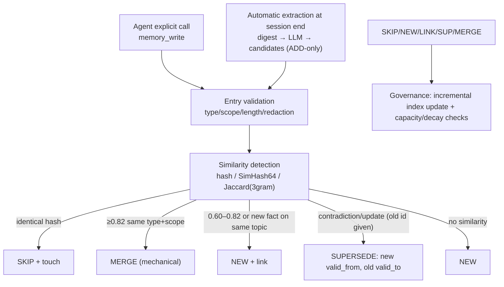

# 04 · Writes and Lifecycle: Extraction, Deduplication, Supersession, Governance, and Forgetting

> 30% of a memory system is "can it store things"; 70% is "**does it know what to remember and what to forget**". The core decision: **ADD-only + bi-temporal supersession + mechanical deduplication** — no LLM-judged rewrites, no LLM deletes (mem0 v3 has already disavowed v2's four operations; ZCode disabling semantic recall by default stems from the same lesson).

## 1. Write path overview



Both write paths share `write/apply.ts`. **No path physically deletes** (`forget` is the exception and goes through the trash).

## 2. Explicit writes (`memory_write`)

```jsonc
{
  "type": "project",                 // user | feedback | project | reference (4 types, aligned across harnesses)
  "category": "decision",            // optional subcategory: decision / convention / lesson / pitfall / state / profile / external
  "scope": "auto",                   // auto | user | project
  "title": "Run the full test suite before committing",   // ≤80 chars
  "description": "Before committing code, run `just test` + the smoke benchmark; rework if any metric regresses beyond the agreed threshold", // ≤200 chars
  "content": "full markdown body…",  // ≤64KB
  "tags": ["tests", "gate"],
  "entities": ["example-project", "just"],
  "importance": 9,
  "pinned": true,
  "evidence": ["dsh:0f1e2d3c#42"],
  "links": ["mem_..."],
  "supersedes": ["mem_..."]          // optional: explicit supersession (used when the model decides "this is a new value for an old fact")
}
```

- `scope=auto`: if the text mentions "user/preference/from now on/global/I usually" and contains no project-specific terms → `user`; otherwise `project`; when unsure, use `project` (can be promoted later).
- `importance` default heuristic: `pinned ? 9 : base[type]` (feedback 7 / user 6 / project 5 / reference 4) + has Why = +1 + has code location = +1 + has numbers/dates = +1, capped at 10.
- Returns `{id, action: NEW|SKIP|MERGE|SUPERSEDE|LINK, superseded:[...], warnings:[]}`; on `SKIP` it reports "already exists, usage time refreshed" so the model does not write duplicates.
- **Never** write: secrets (passwords, tokens, ID numbers); a scan hit is redacted to `[REDACTED]` with a warning. Also reject stable instructions already covered by AGENTS.md/CLAUDE.md (report "already covered by an instruction file").

## 3. Automatic extraction (session end / after compaction)

### 3.1 Trigger conditions (all must hold)

| Condition | Default | Rationale |
|---|---|---|
| Substantive turns | ≥ 3 real user messages | Filter greetings and pure tool noise (ZCode rule) |
| Main model already wrote memories this session | 0 | Avoid duplicates when it already recorded something deliberately (ZCode skips) |
| Digest length | ≥ 500 chars | Too little signal to justify an LLM call |
| Since last extraction | idempotency key `sessionId+digestHash` not yet processed | Prevent repeats |
| Config | `write.autoExtract=true` | Can be disabled |
| Host LLM | available | No model → tool-only writes |

Extraction **never blocks the foreground**: pi uses a self-timeout of 8s inside `session_shutdown` (pi waits for shutdown with no timeout!); DSH uses a background task. v1 **does not** retry via a queue (`state/queue/` is reserved for v0.2); failures are recorded only in the audit log / `ExtractResult.status`.

### 3.2 Digest construction

- Implementation (`buildDigest` in `packages/core/src/extract.ts`): total budget **6000 chars**, **filled newest-first** (recent content wins); whitespace in each message is collapsed to single spaces, each message is truncated to **1200 chars**, line format `User: …` / `Assistant: …` / `Tool: …`;
- Existing-memory list `buildExistingList`: one line per memory `- [mem_id] (type) title — description`, at most **60**; renders `(none)` when empty;
- These rendered values are filled into `{{transcript}}` / `{{existing_memories}}` / `{{observation_date}}` by `fillPrompt` (`packages/core/src/assets.ts`); the rendered format is a prompt/engine contract — read `prompts/README.md` before changing it;
- **Observation date** (mem0 rule): give the model `Observation Date: <ISO>` so "today" is never written as absolute history; undated relative expressions are resolved against that date.

### 3.3 Extraction output (ADD-only)

```jsonc
{
  "memories": [{
    "type": "project", "category": "decision",
    "scope": "project",
    "title": "...", "description": "...", "content": "...",
    "tags": ["..."], "entities": ["..."],
    "importance": 0-10, "confidence": 0-1,
    "links": ["mem_existing_1"],          // related older memories (weak association)
    "supersedes": ["mem_existing_2"],     // only when this is clearly "a new value for an old fact"
    "evidence": ["pi:sess#turn"]
  }],
  "noop_reason": "optional"
}
```

Rules (written into `prompts/extract.md`; on first open the engine deploys the repo defaults as an editable copy at `<home>/prompts/extract.md`; the loading contract is documented in `prompts/README.md` and `packages/core/src/assets.ts` — strip HTML comments, split on `## system`/`## user`, fill placeholders in the user section only, once):

1. Extract only **durable, reusable** facts: user identity/preferences; project decisions and their rationale; pitfalls hit before; stable workflows/conventions; external references (URLs/issues).
2. Do not extract: temporary progress, one-off tasks, raw tool output, secrets, model guesses, or instructions already in AGENTS.md.
3. Record in the same language as the conversation (Chinese conversation → Chinese memory), but use English kebab-case for `name`.
4. At most 6 memories; prefer fewer; if nothing qualifies, `{"memories":[]}`.
5. Conflicts allow only "new value + supersedes old id"; **never** output delete/update commands.
6. Every memory includes `Why:` (why it matters) and `How to apply:` (when to use it) — mandatory for feedback/project types.

**Parsing**: strip the ```json fence → find the balanced `{}` → `JSON.parse`; on failure fall back to rule-based extraction (strong-signal lines: 必须/禁止/以后/记住/remember, ≤3 memories, importance ≤6) and log an audit entry. `confidence < 0.5` is not persisted, only audited.

## 4. Similarity detection and decisions (zero LLM, tunable thresholds)

### 4.1 Features

| Feature | Computation | Purpose |
|---|---|---|
| Exact hash | `sha256(normalize(title)+normalize(body))` | Exact duplicates |
| SimHash64 | token weights tf·idf, 64-bit; popcount Hamming distance | Cheap near-duplicate candidate screening (O(1)) |
| Jaccard(3gram) | character 3-gram set similarity | Precise near-duplicate decision |
| Tag/entity overlap | Jaccard | Link candidates |

`normalize`: NFKC, lowercase, strip whitespace, strip markdown decoration (`**`/`#`/list markers). A write first computes SimHash, recalls candidates from SimHash buckets of the same scope (Hamming ≤3), then applies Jaccard.

### 4.2 Decision table

| Condition | Action | Notes |
|---|---|---|
| Exact hash match | `SKIP` (touch `last_used/used_count`) | Same memory written twice |
| Same type+scope, Jaccard ≥ 0.82, no substantive value conflict (numbers/dates/versions/paths differ) | `MERGE` (mechanical) | Keep the fuller body; merge `provenance`; `importance=max`; `used_count` summed; `updated=now` |
| 0.60 ≤ Jaccard < 0.82 | `NEW + link` | Likely synonymous but not merged; only links (no information lost) |
| Explicit `supersedes`, or same type+scope with Jaccard ≥ 0.60 and an exclusive-update cue (`改为/不再/替换/v2/必须/禁止`) | `SUPERSEDE` | Bi-temporal; old record `valid_to=now`, `superseded_by=new`, `status=superseded` |
| No similarity | `NEW` | |
| Conflict with a pinned record | `SUPERSEDE` (new version) + copy in `conflicts/` + warning | Pinned facts can be updated too, but keep a copy for human review |
| Similar to an archived record | `NEW + link` (or supersede to resurrect) | Resurrection when old conclusions are overturned by new evidence |

**Never**: merge entries with 0.60–0.82 similarity into one (loses information); use an LLM to decide UPDATE/DELETE; physically delete old versions.

### 4.3 Supersession chains (bi-temporal)

- The old record keeps its full text; `valid_to` and `superseded_by` stay bidirectionally consistent; `memory_read` returns the latest by default, `--as-of <date>` returns a historical version;
- `status=superseded` records are excluded from "current facts" search and injection by default, but `search --include-history` can hit them (marked `(historical)`);
- Chain length > 5 → consolidate compresses the chain into a single "final state + decision history" memory (old records go to archive, retaining the provenance chain).

## 5. Consolidation (the "dream" pass)

Triggers: the first session after the write counter reaches `governance.consolidateEveryWrites` (config default **200**, `packages/core/src/config.ts:60`); the first session of each day (lightweight: mechanical operations only); manual `harnmem consolidate [--force] [--dry-run]`.

| Phase | Work | LLM |
|---|---|---|
| P1 mechanical | Exact/near-duplicate merges; supersession-chain compression; backlink recomputation | no |
| P2 topic pages | Generate/rewrite `digests/<scope>/<topic>.md` for high-value clusters (≤200-line summary + referenced ids); previous versions go to `digests/.history/` | yes (optional, ≤10 clusters per run) |
| P3 decay | Compute value/retention per §6 and migrate status | no |
| P4 capacity | Over soft budget → archive from lowest value up; pinned/used-within-90-days are exempt | no |
| P5 index | Validate manifest seq, remove orphans, rebuild shards | no |

Safety rules: every run emits a `ConsolidationReport`; the merge map is written to `archive/consolidation-<date>.json`, `harnmem undo <runId>` restores on a best-effort basis; automated flows **never physically delete**; a single run makes ≤10 LLM calls and uses ≤100k tokens total.

## 6. Value scoring, decay, and state machine

### 6.1 Value score (accounted on write, consumed on read)

```text
value(m) = 0.35·(importance/10) + 0.20·confidence
         + 0.15·min(1, log1p(used_count)/log1p(20))
         + 0.15·pin + 0.10·sourceTrust + 0.05·recency_norm
sourceTrust: user's own words 1.0; tool/command output 0.8; model inference 0.5; second-hand summary 0.4
recency_norm = exp(-ln2·ageDays/180)
```

### 6.2 Retention (simplified Ebbinghaus)

```text
R(t) = e^(−t/S)   S = S0 · (1 + ln(1+used_count)) · (pinned ? 3 : 1)
S0 default 90 days; t = now − max(last_used, updated)
```

### 6.3 State transitions

```
active ──(R<0.30 and not pinned and type ∉ {user, feedback})──▶ archived
archived ──(R<0.05 and unused for 90d and not pinned)────────▶ dropped (into trash/)
any ──(user forget)──▶ dropped (into trash/, 30-day grace by default)
any ──(superseded)──▶ superseded (queryable history, not injected)
archived ──(hit/restore)──▶ active (reset R, audit recorded)
```

- `pinned` is immune; `user`/`feedback` types are not auto-archived by default (they are the most stable long-term memories);
- `archived` is not searched/injected by default; `memory_read` can read it, `search --include-archived` can find it;
- **Archiving is not deletion**: the file stays in `memories/`; only `status` changes and the index rank drops;
- Value thresholds are calibrated in `evals/` against the S9 10k pool; changing weights must pass the gate (05).

## 7. Deletion, recycling, and privacy

| Operation | Behavior |
|---|---|
| `memory_forget(id)` | Move to `trash/`, remove from the index, write an audit entry; **30-day grace** |
| `memory_restore(id)` | Move back from `trash/`, `updated=now`, rebuild the index |
| `memory_forget --hard id` (explicit user request) | **Immediately physically delete** the file + related index entries; the audit keeps only `{id, ts, reason:"user-hard-delete"}` (no body) — satisfying "when the user asks to forget, it must really be gone" |
| `harnmem purge` | Clean trash entries older than 30 days; requires an explicit run (never automatic) |
| Manual .md edit | mtime/hash change → re-parse, validate, rebuild that record's index entry; append `manual` to provenance |
| Manual .md deletion | doctor reports and cleans the orphaned index entry; no automatic restore |

**Privacy red line**: records marked `sensitive: true` are not injected or searched by default (unless `--include-sensitive`); hard-deletion leaves no body copy behind.

## 8. Capacity and governance

All values below are **config defaults** (`DEFAULT_GOVERNANCE` in `packages/core/src/config.ts:56-61`), not hard-coded limits; they can be raised in the `governance` section of `~/.harnmem/config.json`.

| Item | Default (config key) | Behavior when exceeded |
|---|---|---|
| user records | **500** (`maxUserRecords`) | Soft budget: health warning at 80%; over limit archives the lowest-value 5% and reports it |
| project records | **3000** (`maxProjectRecords`) | Same as above; each project is counted independently |
| single body | **65536 B = 64 KB** (`maxBodyBytes`) | Write rejected with a suggestion to split |
| consolidation trigger | **200** writes (`consolidateEveryWrites`) | Mechanical consolidation runs at the next session (see §5) |
| trash grace | **30 days** (`trashGraceDays`) | Expired entries are removed only by an explicit `harnmem purge`; never auto-deleted |
| session logs | 30 days of hot data | Compressed and archived after extraction |

Capacity is a soft budget: a health warning at 80%, and at 100% the next consolidate archives (not deletes) automatically. **No hard count caps** — the requirement is "store more", so governance relies on value ordering rather than record-count limits.

## 9. Audit and observability

`state/audit.jsonl` is append-only: `{seq, ts, kind, harness, session, ids[], action, reason, tokens, ruleVersion}`, kind ∈ inject/write/merge/supersede/archive/forget/consolidate/extract. Malformed lines are skipped, never blocking.

`memory_stats` output: per-scope counts/bytes/pinned; index seq/stale/overhead; health (duplicateCandidates/orphans/lastConsolidate); extraction queue (pending/failed/skipReasons).

## 10. Relationship to migration

Migrated writes go through the same apply pipeline (action=`MIGRATE`), so automatic dedupe applies; they do not trigger automatic extraction; the original directories are untouched; `--dry-run` previews the result. After migration, `used_count/last_used/importance` are preserved; pi records without importance use the type heuristic (5).
